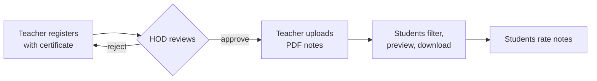
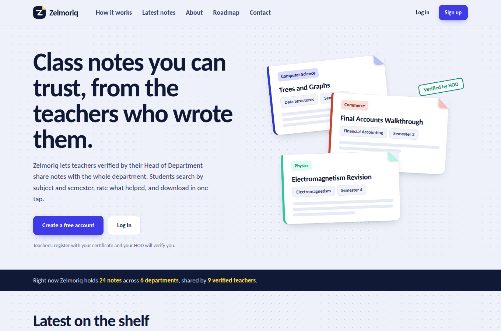
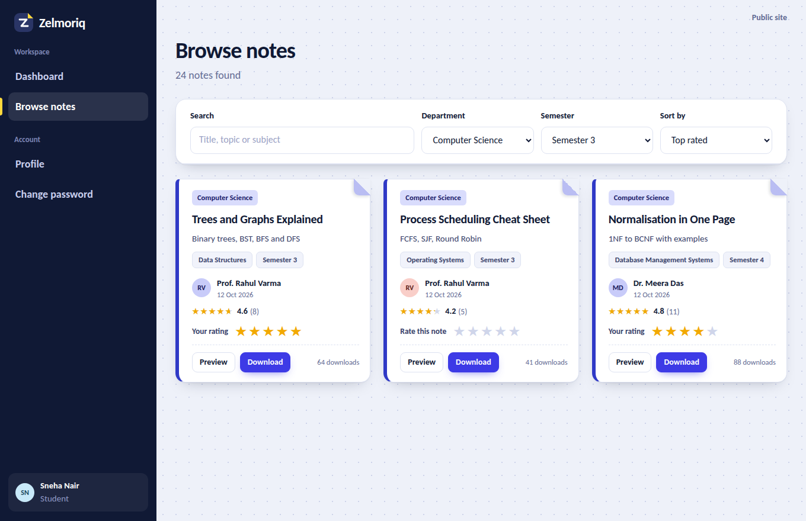
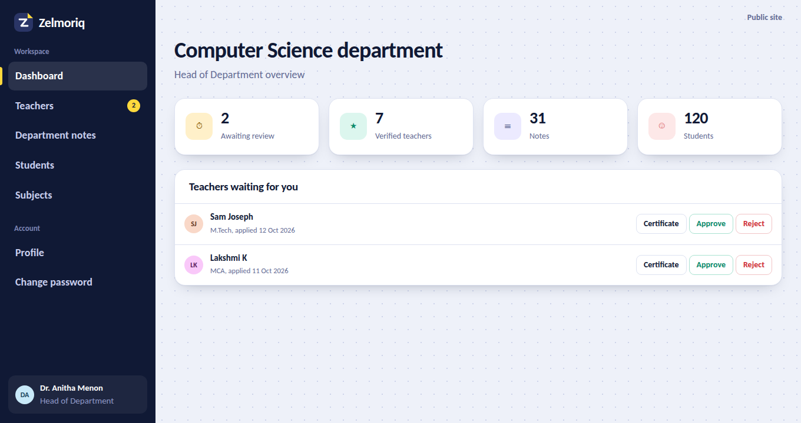
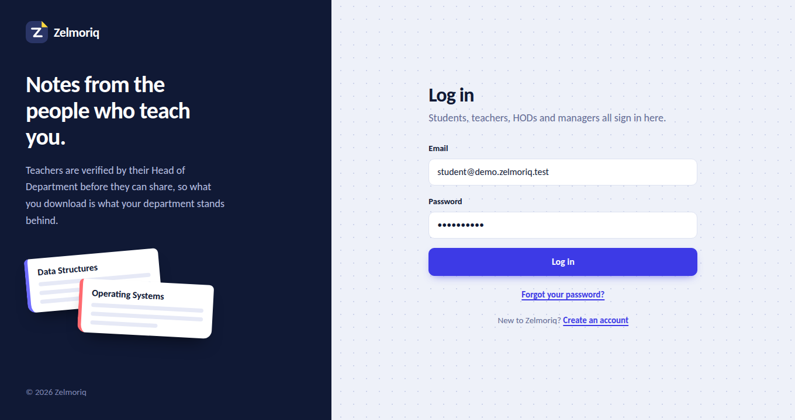

<div align="center">


# Zelmoriq

**A college notes-sharing portal where HOD-verified teachers publish and students find, rate and download.**

[](https://github.com/lufxi/zelmoriq/actions)
[](https://www.php.net/)
[](https://mariadb.org/)
[](LICENSE)
[](docs/AGILE_PLAN.md)
[](CONTRIBUTING.md)

[Quick start](#-quick-start) ·
[Features](#-features) ·
[Screenshots](#-screenshots) ·
[Security](#-security) ·
[Roadmap](#-roadmap) ·
[Contributing](#-contributing)

</div>

---

## Why Zelmoriq?

Class notes usually live in scattered chat groups: nobody knows who wrote them, which semester they belong to, or whether they are any good. **Zelmoriq** fixes that with one rule: *a teacher must be verified by their Head of Department before anything is published.*

Students then filter by department, subject and semester, preview the PDF, download it and rate it.



## ✨ Features

| | |
|---|---|
| 🔐 **One login, four roles** | Student, Teacher, HOD and Manager share a single secure sign-in |
| 🛡️ **Verified publishing** | Teachers upload a certificate; only their HOD (or the manager) can approve them |
| 🔎 **Smart browsing** | Search, filter by department / subject / semester, sort by newest, top rated or most downloaded |
| ⭐ **Star ratings** | One rating per student per note, changeable later |
| 📄 **Safe file handling** | PDFs are served through login-checked scripts, never by direct URL |
| 🧑‍🏫 **HOD tools** | Approve teachers, view certificates privately, moderate notes, export students to CSV |
| 🧰 **Manager console** | Departments, courses, subjects, HOD accounts, user management, contact inbox |
| 📱 **Responsive design** | Graph-paper look with note "sheets", works on phones and desktops |
| 🔍 **SEO ready** | Meta tags, Open Graph, JSON-LD, `robots.txt` and `sitemap.xml` generated automatically |

## 📸 Screenshots

> Design previews rendered from the project's real stylesheet. Replace them with screenshots of your own running site in `docs/screenshots/`.

<table>
  <tr>
    <td width="50%"><br><sub><b>Landing page</b></sub></td>
    <td width="50%"><br><sub><b>Student: browse, rate, download</b></sub></td>
  </tr>
  <tr>
    <td width="50%"><br><sub><b>HOD: verify teachers</b></sub></td>
    <td width="50%"><br><sub><b>One login for every role</b></sub></td>
  </tr>
</table>

## 👥 Roles

| Role | What they can do |
|---|---|
| **Student** | Register with course and semester, browse and filter notes, preview, download, rate |
| **Teacher** | Register with certificate; once approved, upload, edit and delete notes |
| **HOD** | Approve or reject teachers in their department, view certificates, remove notes, export students, manage subjects |
| **Manager** | Everything above plus departments, courses, HOD accounts, all users and the contact inbox |

## 🚀 Quick start

**You need:** [XAMPP](https://www.apachefriends.org/) (or any PHP 8+ and MySQL/MariaDB stack) and a browser.

```bash
# 1. Get the code into your web root (XAMPP: C:\xampp\htdocs)
git clone https://github.com/lufxi/zelmoriq.git
cd zelmoriq

# 2. Create your local config
cp config/config.example.php config/config.php     # Windows: copy config\config.example.php config\config.php
```

1. Start **Apache** and **MySQL** in XAMPP.
2. Open **phpMyAdmin** → **Import** → choose `database/zelmoriq.sql`.
3. Edit `config/config.php` only if your MySQL user or password differs from the XAMPP default.
4. Visit **`http://localhost/zelmoriq/setup.php`**, create the Manager account (tick the demo box for sample data).
5. **Delete `setup.php`**, then log in at **`http://localhost/zelmoriq/login.php`**.

Demo accounts (only if you ticked the box), password `Zelmoriq@123`:

| Role | Email |
|---|---|
| HOD | `hod@demo.zelmoriq.test` |
| Teacher | `teacher@demo.zelmoriq.test` |
| Student | `student@demo.zelmoriq.test` |

> Delete the demo accounts before going live: **Manager → All users**.

## 🧱 Tech stack

- **Backend:** PHP 8 (procedural, PDO prepared statements, no framework)
- **Database:** MySQL / MariaDB with foreign keys, one unified `users` table
- **Frontend:** hand-written CSS design system and a small vanilla-JS file (no Bootstrap, no jQuery, no CDN scripts)
- **Fonts:** Bricolage Grotesque and Figtree from Google Fonts, with system fallbacks

## 📁 Project structure

```
zelmoriq/
├── config/        config.example.php (copy to config.php)
├── includes/      bootstrap (security, db, auth), helpers, layout
├── css/  js/      design system and small enhancements
├── student/       dashboard, browse notes, rating
├── teacher/       dashboard, upload, my notes, edit
├── hod/           dashboard, teachers, notes, students, subjects
├── manager/       dashboard, HODs, departments, courses, subjects, users, messages
├── database/      zelmoriq.sql (schema + reference data), sample PDFs
├── docs/          AGILE_PLAN.md, BUG_FIX_LOG.md, PUBLISHING.md, screenshots
└── uploads/       user files (protected by .htaccess)
```

## 🔒 Security

- CSRF token on every form; all state changes use `POST`
- Prepared statements everywhere (no string-built SQL)
- Passwords hashed with `password_hash` (bcrypt) and a strength policy
- Login throttling: 5 failed attempts per email + IP in 10 minutes
- Uploads: extension + real-content (MIME) check, random filenames, script execution blocked in `uploads/`
- Notes and teacher certificates served only after role checks
- Password-reset tokens stored hashed, valid for one hour
- Private pages send `noindex` so search engines never list them

Found a vulnerability? See [SECURITY.md](SECURITY.md).

## 🗺️ Roadmap

Zelmoriq is planned with **Agile Scrum**: two-week sprints, a prioritised backlog and a retrospective each cycle. See [docs/AGILE_PLAN.md](docs/AGILE_PLAN.md).

- [x] Unified login, roles and secure uploads
- [x] Teacher verification by HOD
- [x] Browse, filter, download and rate notes
- [x] Manager console and contact inbox
- [ ] E-mailed password resets and notifications
- [ ] Favourites and recently viewed notes
- [ ] Comments / questions on notes
- [ ] Support for DOCX and PPTX notes
- [ ] Automated tests (PHPUnit)

## 🤝 Contributing

Contributions are welcome. Please read [CONTRIBUTING.md](CONTRIBUTING.md) first, and open an issue to discuss big changes. Everyone participating agrees to the [Code of Conduct](CODE_OF_CONDUCT.md).

## 📚 Documentation

| Doc | Contents |
|---|---|
| [AGILE_PLAN.md](docs/AGILE_PLAN.md) | Vision, backlog, sprints, definition of done |
| [BUG_FIX_LOG.md](docs/BUG_FIX_LOG.md) | Every defect fixed from the original portal |
| [PUBLISHING.md](docs/PUBLISHING.md) | GitHub, hosting and search-engine setup |
| [CHANGELOG.md](CHANGELOG.md) | Release history |

## 👩‍💻 Team

Built as a college project by **Fathima Nahan E.A** (lead developer), **Fathimma Asif** (database) and **Saeeda K S** (UI/UX).

## 📄 License

Released under the [MIT License](LICENSE).

<div align="center"><sub>If Zelmoriq helps you, consider giving it a ⭐ on GitHub.</sub></div>
